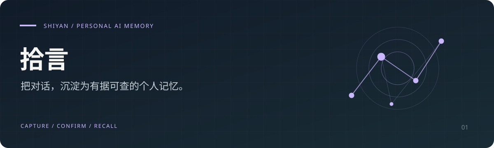

<p align="center"></p>

<h1 align="center">Shiyan · 拾言</h1>
<p align="center"><b>Turn AI conversations and personal experiences into memories you can verify, revise, and reuse.</b></p>
<p align="center"><a href="README.md">简体中文</a> · English · <a href="docs/QUICK_TOUR.md">5-minute walkthrough</a></p>

Shiyan is a personal AI memory app. Paste conversations from different AI tools, keep the original text, extract candidate memories, and confirm them before using them in questions or reflection.

The current interface is primarily in Chinese. This page is an English introduction to the project.

**[Try the hosted app](https://shiyan-beta.onrender.com/)** · Email-code sign-in; model features require your own provider configuration.

## What makes it useful

- **Keep the evidence.** Open the original conversation from a memory to check where it came from.
- **Review before reuse.** Confirm or revise candidate memories; revisions preserve history.
- **Ask with sources.** Ask questions using confirmed memories and inspect the cited memory IDs.
- **Keep plans separate from events.** Generate exploration steps and record what actually happened yourself.
- **Choose your model.** Configure DeepSeek, GLM, Qwen or Kimi; export Markdown.

## Try the workflow

1. Follow the [walkthrough](docs/QUICK_TOUR.md) using fictional data.
2. Create a topic and paste a conversation, or add a memory manually.
3. Configure a model to extract candidate memories; open the evidence and confirm or revise them.
4. Ask a question or generate a plan using confirmed memories.

Saving source text and adding memories manually do not require a model API key. Real extraction and model answers require your own provider configuration.

## Current boundaries

Shiyan v1.3.0 uses keyword retrieval, selecting at most 24 memories and their evidence from up to 500 recent confirmed memories. It does not yet provide vector retrieval, automatic collection from other AI accounts, automatic conflict merging, or cross-app memory APIs.

By default, model calls use confirmed ordinary memories. Private or sensitive memories require permission for each call. Selected content is sent to your configured model provider. Citation validation does not guarantee semantic correctness.

Memories, source text and revisions persist. Q&A and planning results currently remain in the page until you leave or refresh; they can be exported.

## Stack and deployment

React · TypeScript · Next.js / Vinext · Drizzle ORM

The current standalone deployment uses Render + Turso. The earlier Sites runtime uses Cloudflare D1; their setup steps differ.

Node.js ≥ 22.13.0 is required:

```bash
git clone https://github.com/chen1904818062-ai/shiyan.git
cd shiyan
npm run install:ci
```

Configure the environment and database using the [standalone deployment guide](deploy/README.md), then build:

```bash
npm run build:standalone
```

Documentation is currently in Chinese:

- [Memory system guide](docs/MEMORY_SYSTEM.md)
- [Account setup](deploy/ACCOUNT_SETUP.md)
- [Local Sites / D1 development](README.zh-CN.md)
- [Changelog](CHANGELOG.md)

## Feedback and support

If this approach is useful to you, **[star the repository](https://github.com/chen1904818062-ai/shiyan)** to follow its progress.

[Report a bug or suggest an improvement](https://github.com/chen1904818062-ai/shiyan/issues). Describe the task you tried, what happened, and what you expected; remove personal conversations and credentials.

Built by [陈宇杰 · kalsookie](https://github.com/chen1904818062-ai).
