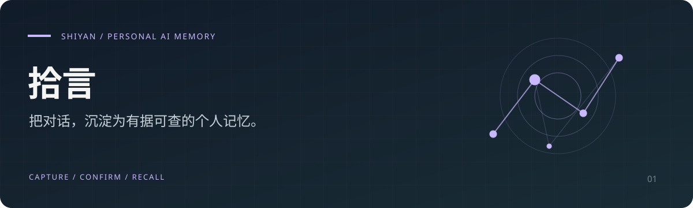

<p align="center"></p>

<h1 align="center">拾言 · Shiyan</h1>
<p align="center"><b>把与 AI 的对话和自己的经历，沉淀为可追溯、可更新、可调用的个人记忆。</b></p>
<p align="center">个人 AI 记忆系统 v1.3.0 · React / TypeScript · Render + Turso</p>
<p align="center"><a href="#功能一览">功能</a> · <a href="#开始使用">开始使用</a> · <a href="#开发与部署">开发部署</a> · <a href="docs/MEMORY_SYSTEM.md">记忆指南</a> · <a href="CHANGELOG.md">更新记录</a></p>

## 为什么做拾言

和 ChatGPT、豆包、DeepSeek 聊过很多，真正需要时却找不到当时的思路。拾言从保存完整对话开始，让总结回到原文，让记忆经过你的确认，再用于问答、探索计划与复盘。

> 对话是原料，记忆是可以长期积累的资产。

## 功能一览

| 能力 | 你能做什么 |
| :--- | :--- |
| 话题与对话归档 | 按主题粘贴多平台对话，保留完整原文，生成详细总结与每周回顾 |
| 个人记忆档案 | 从对话提炼候选记忆，也可手动补充经历、目标和偏好 |
| 证据与修订 | 回跳原文核对引文，确认、修订或归档记忆，保留修订历史 |
| 与记忆对话 | 基于已确认记忆回顾和分析，回答附来源 |
| 规划与复盘 | 生成探索步骤与验证方式，由你主动记录实际行动反馈 |
| 多模型与导出 | 配置 DeepSeek、智谱 GLM、通义千问或 Kimi，导出 Markdown |

## 开始使用

1. **保存原料**：登录后在「我的话题」创建话题，粘贴对话；也可在「我的记忆」直接补充经历。
2. **配置模型**：选择提供商，填写 API Key 并选择可用型号。没有密钥时，仍可保存原文与手动记忆。
3. **提炼并核对**：提炼候选记忆，展开证据查看原句，确认、修订或标记不准确。
4. **调用与复盘**：在「与记忆对话」提出问题，或进入「规划与复盘」生成建议、记录反馈。

完整操作及数据生命周期见 **[记忆系统使用指南](docs/MEMORY_SYSTEM.md)**。

## 数据与调用边界

- **主动导入**：当前通过粘贴保存文本，不会自动连接或读取你的其他 AI 账号。
- **先确认再调用**：默认只调用已确认的普通记忆；私密、敏感记忆需每次明确允许。所选内容会发送给你配置的模型提供商。
- **有出处，可核对**：当前用关键词检索，最多发送 24 条记忆及证据；没有向量检索，可能遗漏同义表达。来源检查不能保证模型判断完全正确。
- **建议由你落实**：规划不等于已发生的经历；问答和规划结果暂存在当前页面，可导出，刷新后不保留。记忆、原文与修订持久保存。
- **账号隔离**：当前独立版支持邮箱验证码登录与个人数据空间隔离；手机验证码需另行配置。

模型目录不代表已验证调用权限。报告分别记录请求型号与接口返回型号；型号不一致、接口未返回型号和旧报告未核验均会提示。

## 开发与部署

当前独立部署使用 **Render + Turso**；原 Sites 运行方式使用 **Cloudflare D1**。两条路径的配置与初始化步骤不同。

| 目的 | 文档与入口 |
| :--- | :--- |
| 部署独立版本 | [独立部署说明](deploy/README.md) |
| 邮箱 / 手机账号配置 | [账号接入说明](deploy/ACCOUNT_SETUP.md) |
| 本地 Sites / D1 开发 | [中文开发文档](README.zh-CN.md)（含早期运行方式说明） |
| 功能边界与验证 | [记忆系统指南](docs/MEMORY_SYSTEM.md) |
| 先前首页中的技术细节 | [开发记录](docs/ENGINEERING.md) |

要求 **Node.js ≥ 22.13.0**。克隆后安装依赖：

```bash
git clone https://github.com/chen1904818062-ai/shiyan.git
cd shiyan
npm run install:ci
```

按对应部署文档配置环境变量和数据库，再构建独立版：

```bash
npm run build:standalone
```

已有自动化检查包括：

```bash
node --test tests/memory.test.mjs tests/memory-system.test.mjs tests/standalone.test.mjs tests/accounts.test.mjs tests/model-config.test.mjs tests/model-catalog.test.mjs tests/summary.test.mjs
```

## 反馈与交流

欢迎通过 [Issues](https://github.com/chen1904818062-ai/shiyan/issues) 反馈使用问题和改进建议。提交问题时请移除私人对话、验证码和 API Key。

由 **[陈宇杰 · kalsookie](https://github.com/chen1904818062-ai)** 独立构建 · 另一个项目：[同频实验室](https://github.com/chen1904818062-ai/tongpinlab)

<sub>Personal AI memory with traceable sources, human confirmation and revision history.</sub>
